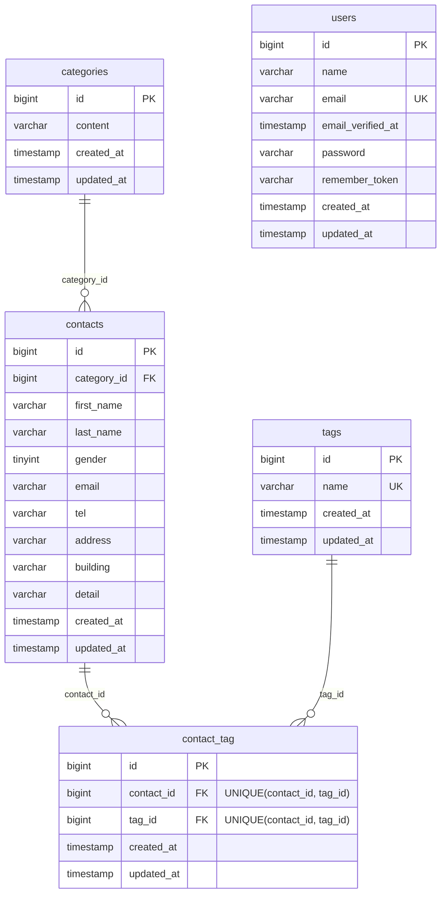

# COACHTECH お問い合わせフォーム

## 概要

一般ユーザーが利用する公開のお問い合わせフォームです。  
誰でもお問い合わせを送信でき、管理者はログイン後にその内容を確認・管理します。

実装した機能は以下のとおりです。

### お問い合わせフォーム

- 入力画面でお問い合わせを入力（入力内容別に入力制限あり）
  - 「確認画面」押下で確認画面へ移動
- 確認画面で、入力したお問い合わせ情報を表示
- 確認画面で内容問題なければ
  - 「送信」を押下で、お問い合わせ登録完了
  - 「修正」を押下で、お問い合わせ入力ページに戻る（直前に入力していた情報は保持された状態で表示）

### 管理画面

管理画面は以下の2つで構成

#### お問い合わせ内容の管理

- 一覧表示（7件ずつ）
- お問い合わせの検索
  - 検索項目：名前もしくはメールアドレス（部分一致で検索可能）、性別、種類、登録日
- お問い合わせ内容の詳細表示
  - 一覧には表示されていない内容も含めて表示、削除ボタンあり

#### タグ管理

- 新規タグの追加
  - 50文字以内、重複登録不可の入力制限あり
- 編集
  - 既存タグの名称変更、新規タグ追加と同様の入力制限あり
- 削除
  - 既存タグを削除（そのタグが付いていたお問い合わせからも、タグの紐づけが自動で外れる）

### 認証

- 管理者登録可能
- 管理者は「管理画面」へのログイン・ログアウト、各種操作が可能

## ER図



## 環境構築手順

プロジェクト名「contact-form-app」を、以下の手順に従って構築してください。

以下のコマンドは、ターミナル（WindowsはWSLのUbuntu）で実行してください。

### 事前準備

#### ① Docker の起動

Docker Desktop（またはDocker Engine）が起動していることを確認してください。

#### ② 他プロジェクトの停止

他のプロジェクトが起動中の場合、以降の作業が正しく実行できません。  
起動中のプロジェクトがあるか、以下を実行して確認してください。

```bash
docker ps
```

「CONTAINER ID」〜「NAMES」の見出し行の下に、表示されるものがあるか確認してください。

- 何も表示されない場合
  - 「1. リポジトリをクローンする」から作業を開始してください。
- 何か表示される場合
  - 「NAMES」に表示されている名前の前半が、起動中のプロジェクトのフォルダ名です（例：「readme-check-laravel.test-1」なら「readme-check」フォルダ）。
  - 起動中のプロジェクトのフォルダで以下を実行し、停止してください。

    ```bash
    ./vendor/bin/sail down
    ```

  - 停止したら、再度 `docker ps` を実行し、見出し行の下に何も表示されなくなったことを確認してから、「1. リポジトリをクローンする」から作業を開始してください。

### 1. リポジトリをクローンする

任意の作業フォルダで、以下を実行してください。

```bash
git clone https://github.com/yoko-77/contact-form-app.git
cd contact-form-app
```

### 2. 依存パッケージ（vendor）をインストールする

以下を実行してください。

```bash
docker run --rm \
    -u "$(id -u):$(id -g)" \
    -v "$(pwd):/var/www/html" \
    -w /var/www/html \
    -e COMPOSER_CACHE_DIR=/tmp/composer_cache \
    laravelsail/php82-composer:latest \
    composer install --ignore-platform-reqs
```

### 3. .env を作成・修正する

以下を実行してください。

```bash
cp .env.example .env
```

`.env` を開き、「DB_CONNECTION」を検索してください。  
データベース接続に関する「DB_CONNECTION」から「DB_PASSWORD」までを、以下に書き換えます。

```
DB_CONNECTION=mysql
DB_HOST=mysql
DB_PORT=3306
DB_DATABASE=laravel
DB_USERNAME=sail
DB_PASSWORD=password
```

テストのカバレッジを表示するため、末尾に以下を追加します。

```
XDEBUG_MODE=coverage
```

上記が完了したら、`.env` を上書き保存して閉じてください。

### 4. Sail を起動する

以下を実行してください。

```bash
./vendor/bin/sail up -d
```

> ⚠️ **M1/M2/M3 Mac（Apple Silicon）をお使いの方**
>
> Apple Silicon搭載のMacでは、`sail up -d` 実行時に以下のエラーが発生することがあります。
>
> ```
> no matching manifest for linux/arm64/v8
> ```
>
> 解決方法：`compose.yaml` を開き、「mysql:」を検索してください。  
> 「image:」の行の直下に `platform: 'linux/amd64'` を追加します。
>
> ```yaml
> mysql:
>     image: 'mysql/mysql-server:8.0'
>     platform: 'linux/amd64'  # ← この行を追加
>     ports:
>         ...
> ```
>
> 編集後、`compose.yaml` を保存して閉じてから、再度上記のSailを起動するコマンドを実行してください。

### 5. Sail のエイリアスを設定する

エイリアスの設定が必要か、以下を実行して確認してください。

```bash
alias sail
```

- 冒頭に「alias sail='…'」または「sail='…'」が表示された場合
  - エイリアスの設定は不要です。  
    「6. アプリケーションキーを生成する」に進んでください。
- 何も表示されない、または「not found」と表示された場合
  - 以下を実行して、使用しているシェルを確認してください。

    ```bash
    echo $SHELL
    ```

  - 末尾が「bash」と表示された場合は、以下を実行してください。

    ```bash
    echo "alias sail='[ -f sail ] && bash sail || bash vendor/bin/sail'" >> ~/.bashrc
    exec $SHELL
    ```

  - 末尾が「zsh」と表示された場合は、以下を実行してください。

    ```bash
    echo "alias sail='[ -f sail ] && bash sail || bash vendor/bin/sail'" >> ~/.zshrc
    exec $SHELL
    ```

  - 実行後、「6. アプリケーションキーを生成する」に進んでください。

### 6. アプリケーションキーを生成する

※ 以降のコマンドは `sail` で実行します。

以下を実行してください。

```bash
sail artisan key:generate
```

### 7. マイグレーションと初期データの投入

以下を実行してください。

```bash
sail artisan migrate --seed
```

※ Sail 起動直後で MySQL の準備ができていない場合、接続エラーになることがあります。  
その場合は少し待ってから再度実行してください。

※ 作業中、既存のデータベースをリセットしたい場合は以下を実行してください。

```bash
sail artisan migrate:fresh --seed
```

### 8. フロントエンドのビルド

以下を実行してください。

```bash
sail npm install
sail npm run build
```

### 9. 動作確認

以下のURLをブラウザで確認してください。

- お問い合わせフォーム：http://localhost
- 管理者登録画面：http://localhost/register
- ログイン画面：http://localhost/login
- 管理画面：http://localhost/admin
  - 初期管理者（シーダーで登録済み）の以下でログインしてください。
    - メールアドレス：test@example.com
    - パスワード：password
- phpMyAdmin：http://localhost:8080

## テストの実行方法

以下を実行してください。

```bash
sail artisan test
```

カバレッジを表示する場合は、以下を実行してください。

```bash
sail artisan test --coverage
```

## 使用技術

- PHP 8.2
- Laravel 10.50.4
- Laravel Fortify 1.36.2（認証）
- Laravel Sail（Docker 開発環境）
- MySQL 8.0
- phpMyAdmin
- Vite 5
- Tailwind CSS 3.4
- Docker / Docker Compose

## APIエンドポイント一覧

公開API（応用機能）は未実装のため、ありません。

## 開発環境URL

- お問い合わせフォーム：http://localhost
- 管理画面：http://localhost/admin
- 管理者登録画面：http://localhost/register
- ログイン画面：http://localhost/login
- phpMyAdmin：http://localhost:8080

## 作成者
yoko-77
